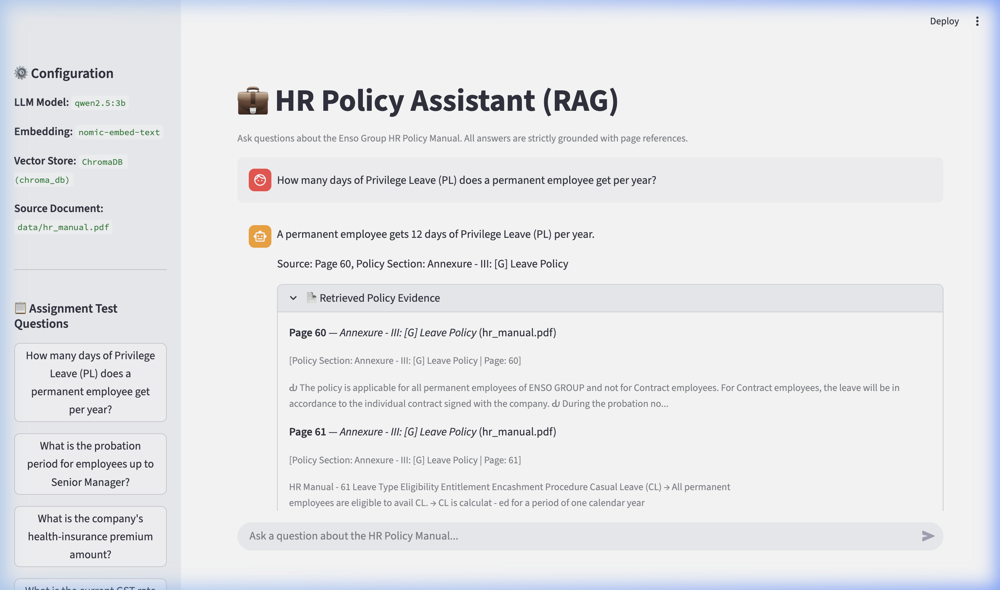
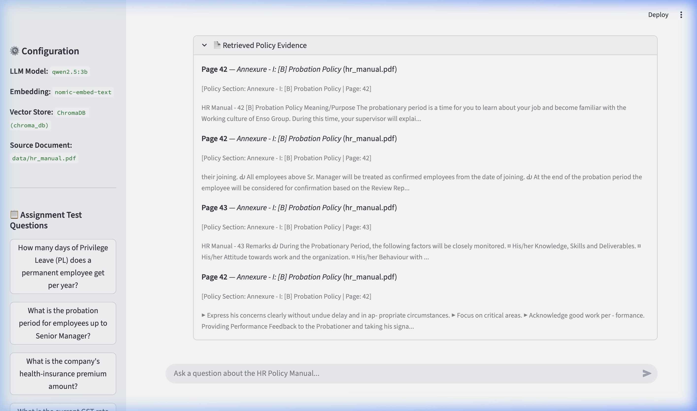
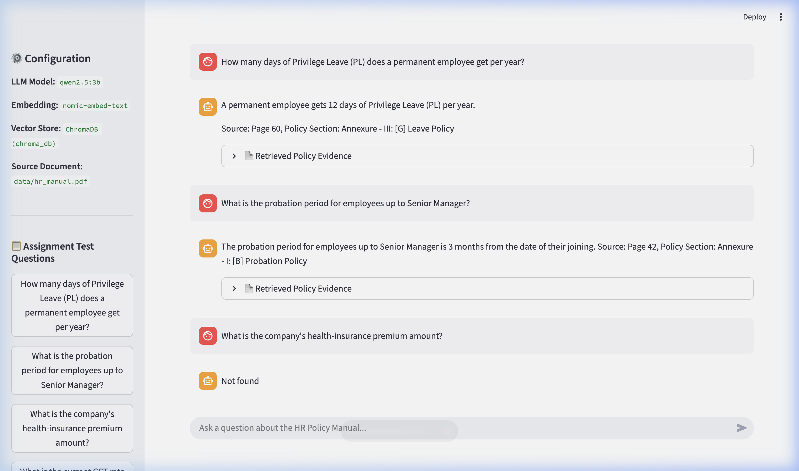
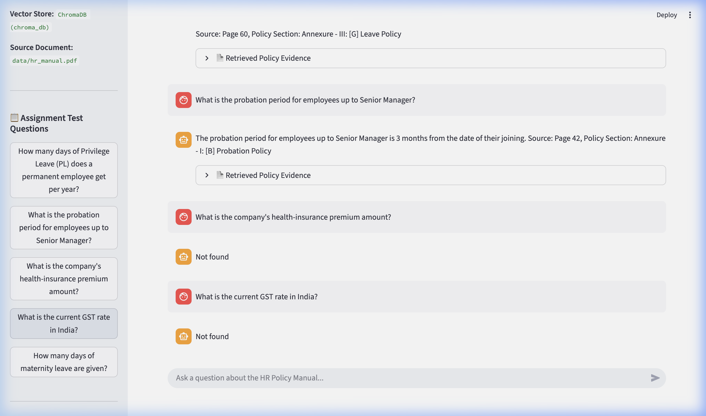
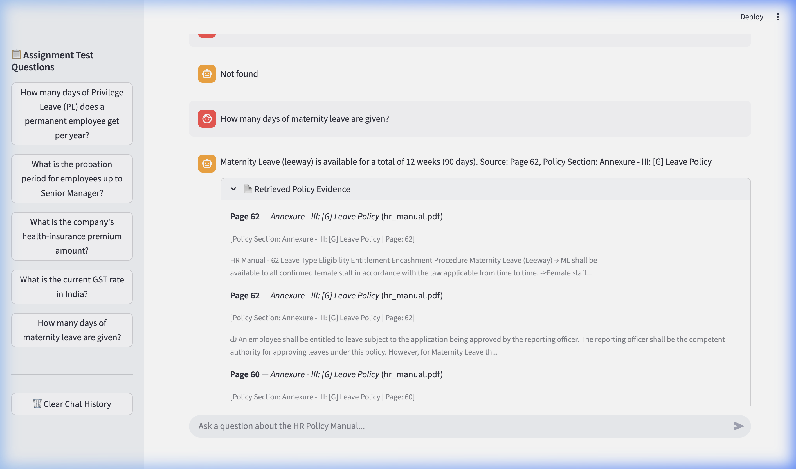
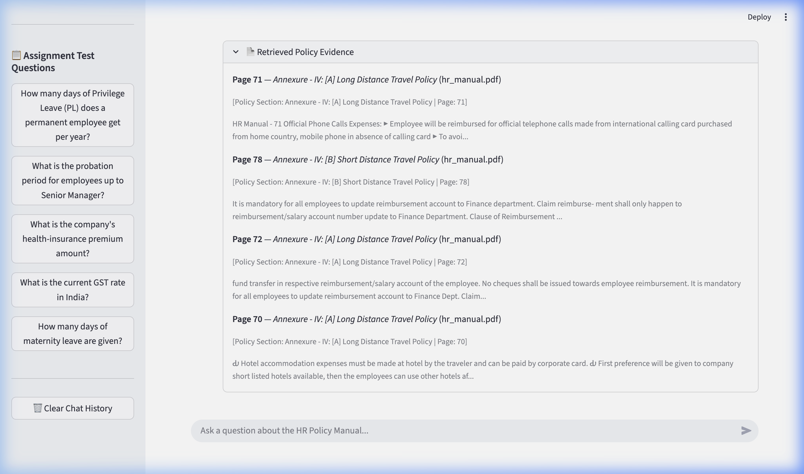

# HR Policy Assistant (RAG) — GenAI Mid-Term Project

A lightweight, local Retrieval-Augmented Generation (RAG) assistant built using **Python**, **LangChain**, **ChromaDB**, **Ollama**, and **Streamlit**.

This assistant answers employee questions based strictly on the **Enso Group HR Policy Manual (79 pages)**. It cites the relevant policy section and page number for supported answers and returns **`Not found`** whenever an answer is not present in the manual.

---

## 🏗️ Architecture & Pipeline Flow

```
[ data/hr_manual.pdf ]
         │
         ▼ (PyPDFLoader - 79 pages)
[ Page Documents + Metadata (Page Numbers) ]
         │
         ▼ (RecursiveCharacterTextSplitter - 700 chars, 120 overlap)
[ 323 Text Chunks ]
         │
         ▼ (OllamaEmbeddings - nomic-embed-text)
[ ChromaDB Vector Store (./chroma_db) ]
         ▲
         │ (Semantic Search - Top 4 Chunks)
[ User Question ] ──▶ [ ChatOllama (qwen2.5:3b) + Grounded Prompt ]
                                │
                                ▼
         [ Accurate Answer with Section & Page Citation ]
                    OR [ "Not found" ]
```

### Key Principles
1. **Strict Document Grounding:** The model is constrained to use only the retrieved context chunks. Speculation, external general knowledge, and hallucinations are forbidden.
2. **Explicit Citations:** Answers cite the exact policy name/section and page number.
3. **Deterministic Fallback:** If the context does not contain the answer, the assistant responds with `Not found`.
4. **Resilient Error Handling:** Gracefully handles missing PDF files, uninitialized vector stores, and Ollama connection interruptions.

---

## 📁 Project Structure

```
.
├── data/
│   └── hr_manual.pdf         # Enso Group HR Policy Manual (79 pages)
├── ingest.py                 # PDF loader, chunking, Ollama embeddings, ChromaDB builder
├── app.py                    # Streamlit chat interface with grounded retrieval
├── requirements.txt          # Python dependencies
├── .env                      # Model and path configurations
├── .gitignore                # Ignored cache, databases, and secrets
└── README.md                 # Setup guide, flow, and exam question answers
```

---

## 🚀 Setup & Execution Guide

### 1. Prerequisites
- **Python:** 3.10 or higher
- **Ollama:** Installed and running locally
- Pull the required Ollama models:
  ```bash
  ollama pull qwen2.5:3b
  ollama pull nomic-embed-text
  ```

### 2. Install Dependencies
```bash
pip install -r requirements.txt
```

### 3. Ingest the HR Manual into ChromaDB
Run the ingestion pipeline to parse `data/hr_manual.pdf`, chunk it into 323 chunks, and build the local vector database:
```bash
python ingest.py
```
*Output will confirm: `Total Pages Processed: 79`, `Total Chunks Stored: 323` into `./chroma_db`.*

### 4. Launch the Streamlit Web App
```bash
streamlit run app.py
```
Open your browser at `http://localhost:8501`.

---

## 📋 Mid-Term Exam Questions & Verified Answers (with UI Screenshots)

Below are the test questions evaluated against the Enso Group HR Manual along with actual Streamlit UI screenshots:

### Question 1: How many days of Privilege Leave (PL) does a permanent employee get per year?
* **Answer:** A permanent employee gets **12 days** of Privilege Leave (PL) per year (calculated per calendar year from 1st Jan to 31st Dec).
* **Reference:** Section `[G] Leave Policy`, Page **60** (`hr_manual.pdf`).



---

### Question 2: What is the probation period for employees up to Senior Manager?
* **Answer:** All employees up to Senior Manager are placed on probation for a period of **3 months** from the date of joining.
* **Reference:** Section `[B] Probation Policy`, Page **42** (`hr_manual.pdf`).



---

### Question 3: What is the company's health-insurance premium amount?
* **Answer:** **`Not found`**
* **Reference:** The Enso Group HR Manual mentions travel insurance coverage for business travel (Page 71), but does not state any health insurance premium amount.



---

### Question 4: What is the current GST rate in India?
* **Answer:** **`Not found`**
* **Reference:** Out-of-scope query. Taxes/GST rates are not part of the Enso Group HR Policy Manual.



---

### Question 5: How many days of maternity leave are given?
* **Answer:** The company provides a total of **12 weeks (90 days)** of Maternity Leave (ML) with pay, of which not more than 6 weeks (45 days) should precede the expected delivery date.
* **Reference:** Section `[G] Leave Policy` (Maternity Leave / Leeway), Page **62** (`hr_manual.pdf`).



---

### Question 6: What is the reimbursement policy for personal phone calls?
* **Answer:** Employees traveling on a business trip are reimbursed for personal phone calls up to a maximum length of **twenty (20) minutes per week (Week = 5 days)**. Personal telephone calls made from **Air phones, Rail phones, or Cellular Car phones** will not be reimbursed.
* **Reference:** Annexure IV: Long distance travel policy — Section `(C.) Personal Phone Calls`, Page **70** (`hr_manual.pdf`).



---

## 🧪 Edge Cases & Error Handling

- **Database Missing:** If `chroma_db` has not been generated, `app.py` displays a warning instructing the user to run `python ingest.py`.
- **Ollama Offline:** If Ollama is not running on `http://localhost:11434`, clear setup guidance is displayed (`brew services start ollama`).
- **Unrelated Questions:** Any question outside the HR manual strictly triggers the `"Not found"` response.
